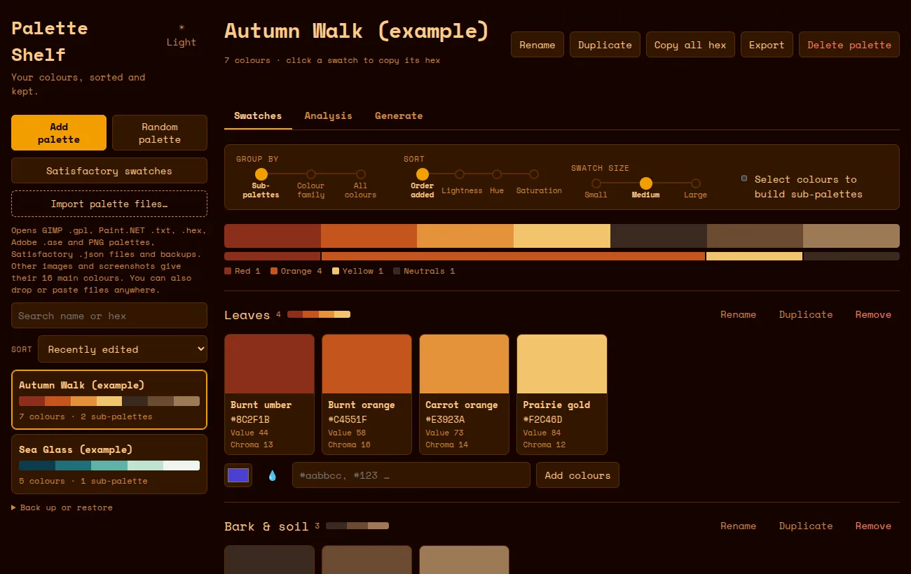

# Palette Shelf

A personal colour-palette manager for Linux. Collect, analyse and generate palettes, then export them for pixel art, slides, code or Satisfactory.

**[Website](https://workwaffle.github.io/palette-shelf/)** · **[Download 2.1.0](https://github.com/WorkWaffle/palette-shelf/releases/tag/v2.1.0)** · **[Try it in your browser](https://workwaffle.github.io/palette-shelf/app/)**



## Features

- **Collect and organise:** palettes with sub-palettes. Edit colours with OKLCH sliders, drag swatches between groups, sort, duplicate, and undo with Ctrl+Z.
- **Analyse:**
  - Contrast grid, and colour-blind and projector checks.
  - Dither test, hue/lightness and chroma maps in the style of Lospec and DawnBringer, and near-duplicate detection.
- **Generate:**
  - A seeded random generator with a harmony wheel. Styles include '90s computing, Gruvbox, '60s, '70s, '80s neon, Vaporwave, Cyberpunk, Pastel, Earthy, Autumn, Ocean and Mono screen. Your own palettes can be used as styles too.
  - It can also fill in between colours, extend ramps and restyle a palette.
- **Import:** GIMP `.gpl`, Paint.NET `.txt`, `.hex`, Adobe `.ase` and PNG palette strips. An image or screenshot gives its 16 main colours. You can drop or paste files.
- **Export:** GIMP/Paint.NET/HEX files, a PNG strip for Aseprite and game engines (1, 8 or 32 px), a labelled PNG swatch sheet for slides, CSS variables, JSON, or a names-and-hex text list.
- **Satisfactory:** builds Universal Swatch Slots sets (primary and secondary pairs) and exports the mod's `.json`.
- **Backups:** saves and restores a backup file, with Add or Replace.

## Download

| File | For |
|---|---|
| `palette-shelf_2.1.0_amd64.deb` | Ubuntu, Mint, Debian. Small (1.6 MB); uses the system WebKitGTK. |
| `palette-shelf-2.1.0-1.x86_64.rpm` | Fedora, openSUSE. |
| `Palette-Shelf-2.1.0-tauri-x86_64.AppImage` | Any distro, no install (80 MB). |
| `Palette-Shelf-2.1.0-electron-x86_64.AppImage` | Any distro (120 MB). The only build with the screen eyedropper. |
| `palette-shelf-2.1.0-standalone.html` | Any OS with a browser, including Windows and macOS. Works offline. |

The [release page](https://github.com/WorkWaffle/palette-shelf/releases/tag/v2.1.0) lists `SHA256SUMS.txt` for checking downloads.

```bash
sudo apt install ./palette-shelf_2.1.0_amd64.deb
```

Saved palettes live in each build's own storage (browser local storage). To move them between builds, use **Back up or restore → Save backup file**, then **Open backup file** in the other one.

## Build from source

The whole app is one file, `palette-shelf.html`, with no framework and no build step. `build.py` wraps it for each target:

```bash
python3 build.py   # writes app/index.html, dist/palette-shelf-windows.html, tauri/www/index.html, docs/app/index.html
```

`build.py` reads the Space Mono font files from `app/node_modules`, so run `npm install` in `app/` first (step 1 of the Electron build below).

**Electron AppImage** (needs Node ≥ 22.12):

```bash
cd app && npm install && npm run dist
```

**Tauri `.deb`, `.rpm`, AppImage** (needs Rust and the WebKitGTK development packages):

```bash
sudo apt install libwebkit2gtk-4.1-dev build-essential libxdo-dev libssl-dev libayatana-appindicator3-dev librsvg2-dev
```

```bash
cargo install tauri-cli --version "^2" --locked
```

```bash
cd tauri/src-tauri && cargo tauri build
```

## Tests

| Script | What it checks |
|---|---|
| `tests/baseline.js` | Snapshot of about 600 generator, export, parse and colour-maths results. The same seed must give the same output. |
| `tests/variety.js` | How varied each generator style is across shuffles. |
| `tests/uishots.js`, `actions.js`, `audit.js`, `motion.js`, `perf.js`, `testuss.js` | Screenshots, scripted click-through, layout across widths, animation and timing (Electron). |
| `tests/webkit_smoke.py`, `tests/tauri_selftest.js` | The app inside WebKitGTK and inside the Tauri build. |

See [CLAUDE.md](CLAUDE.md) for the code map, project rules and exact test commands. [REVIEW.md](REVIEW.md) and [NATIVE.md](NATIVE.md) cover the 2.0 design review and the move to Tauri.

## License

[MIT](LICENSE). The harmony wheel is adapted from Harmony Genny by delphitools (0BSD).
